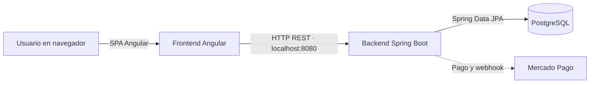

# 2. Arquitectura

## Vista general

El sistema se despliega como dos aplicaciones separadas: Angular sirve la interfaz web y Spring Boot expone la API REST. PostgreSQL es la base de datos principal declarada por el backend. El frontend consume la API por HTTP.

La relación con Mercado Pago está declarada en el README backend. El flujo y el estado de su configuración se detallan en [Integraciones](08-integraciones.md).

## Frontend

- `src/app/pages/`: pantallas organizadas por flujo (inicio, sucursales, autenticación, configuración y reserva).
- `src/app/components/`: componentes reutilizables de navegación, equipo, reseñas y verificación.
- `src/app/services/`: llamadas HTTP y estado de autenticación.
- `src/app/models/`: tipos TypeScript para los DTO que consume o envía la interfaz.
- `src/app/guards/`: guardas de autenticación, visitante y verificación.
- `src/app/interceptors/` y `src/app/http/`: envío de credenciales y tratamiento central de errores.
- `src/app/app.routes.ts`: rutas; varias páginas de cuenta están conectadas a un componente de sección genérico y no prueban por sí solas que la función esté completa.

La URL base de la API está fijada en `src/app/services/backend-service.ts` como `http://localhost:8080`; no hay un archivo de configuración por ambiente identificado en este checkout.

## Backend

El README publicado del backend documenta esta organización por capas:

`Controllers → Services → Repositories`, con DTO, entidades/modelos, seguridad JWT, configuración y manejo de excepciones. La estructura y los comandos se mantienen en el [README backend](https://github.com/appointmee/appointmee-back#arquitectura).

## Diagrama de componentes

El diagrama mantenido como fuente está en [diagramas/appointmee.mmd](diagramas/appointmee.mmd). No se encontró un diagrama C4 o de despliegue dentro del checkout frontend.
